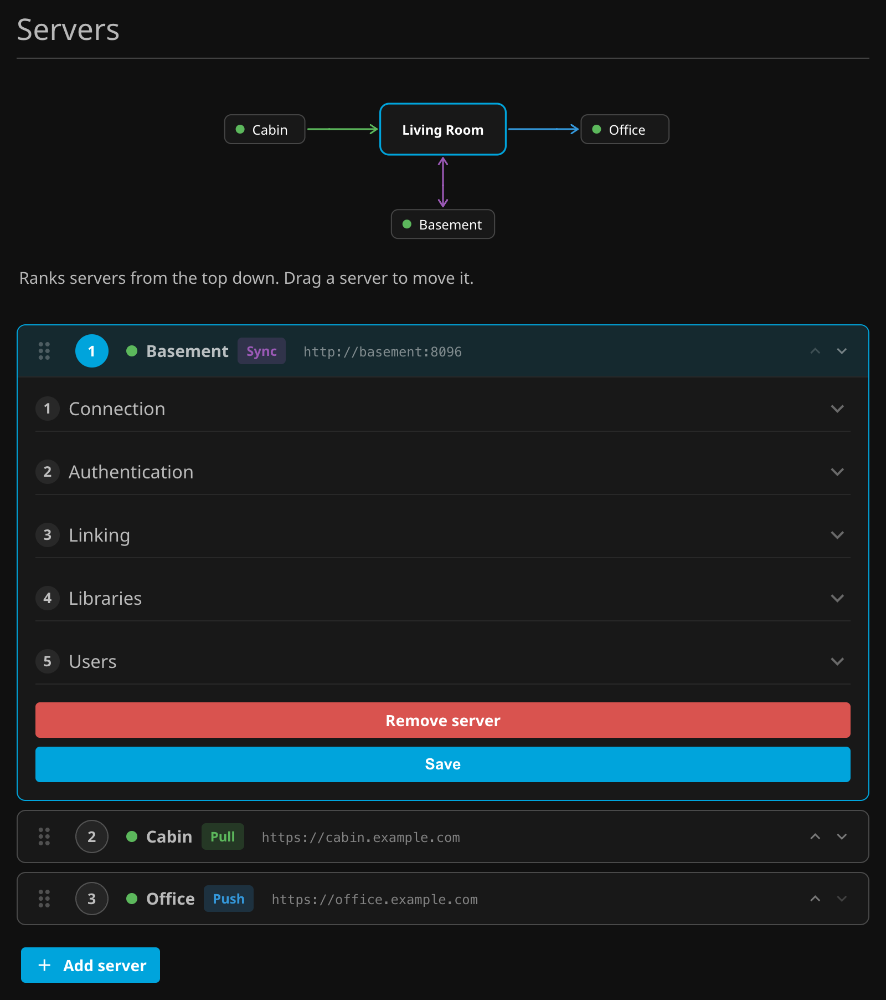
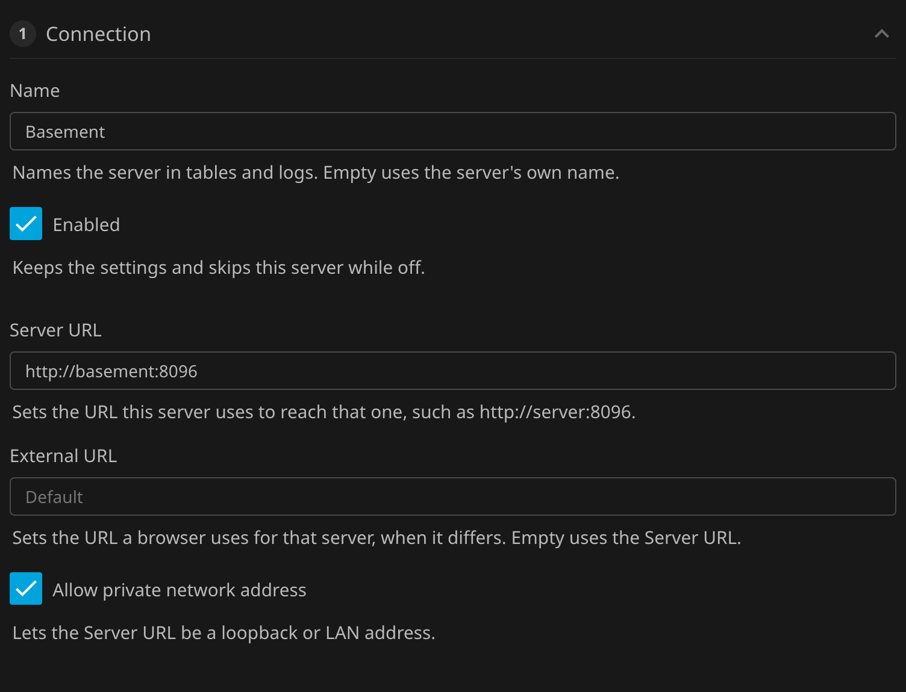
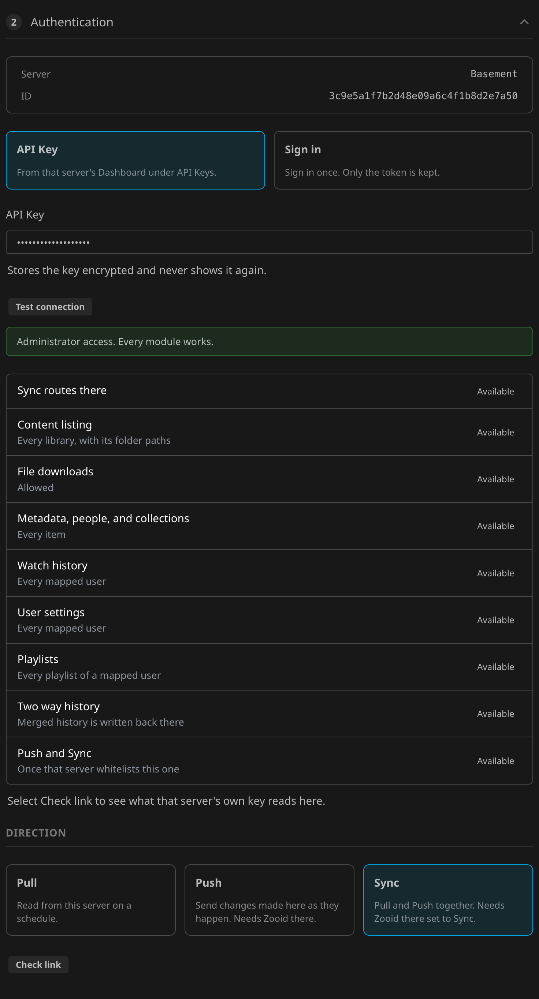
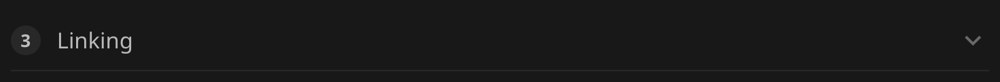
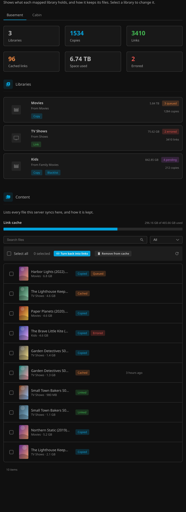
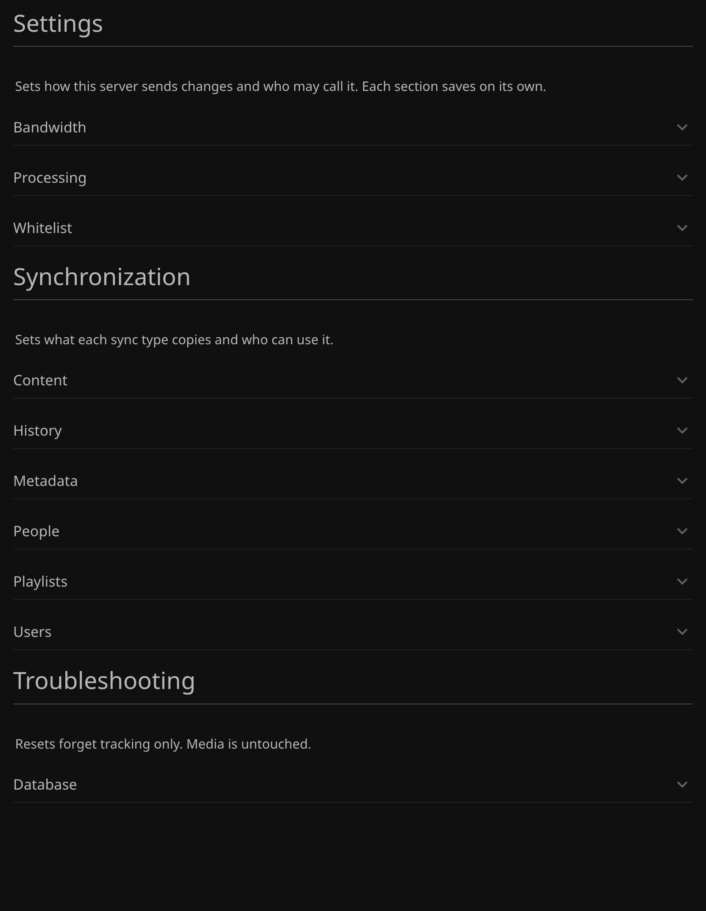
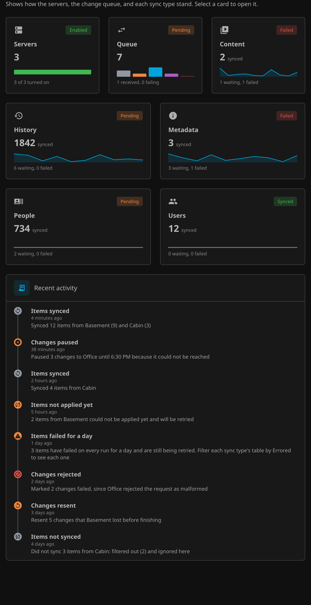
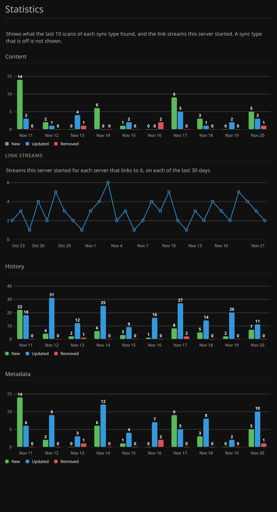
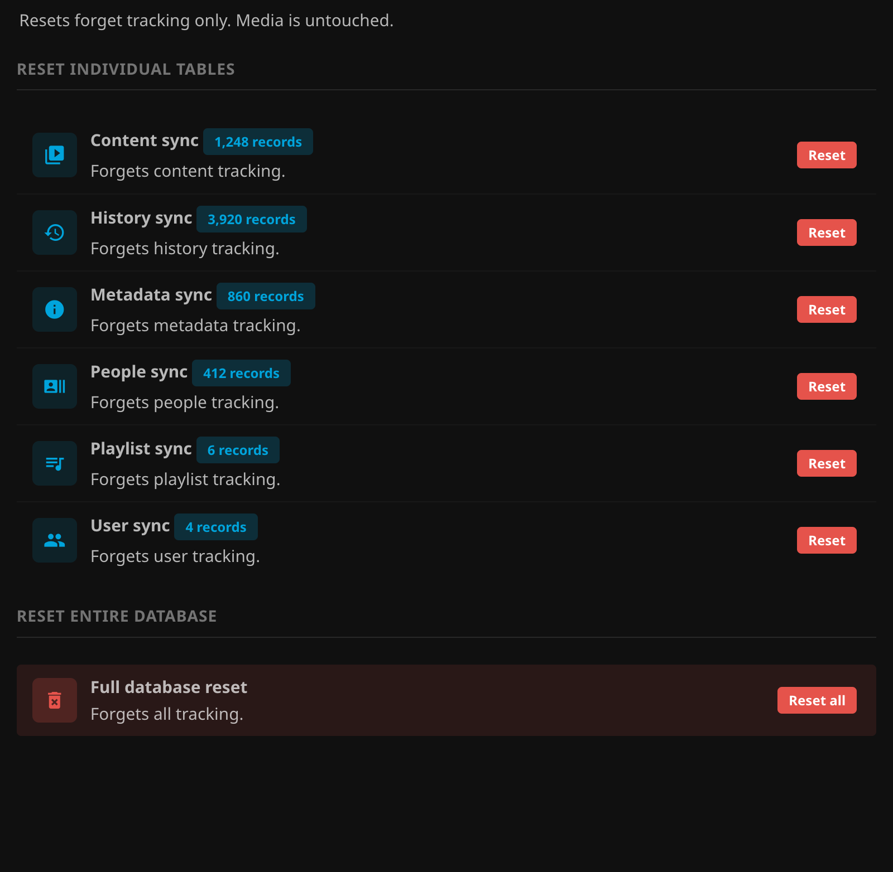

# Setup

This page walks through a first setup, from opening the Zooid page to reading the **Dashboard**. Install the plugin first, as described in [Installation](Installation.md).

## The Zooid Page

Open **Zooid** from the dashboard menu. Zooid is one page with a sidebar of tools, and it opens on the **Dashboard**. The button at the top of the sidebar folds it to its icons. A tool with nothing to show is left out of the sidebar. Each sync type has its own tool, which joins or leaves the sidebar as soon as that type is turned on or off.

| Tool | What it holds | Shows while |
| :--- | :--- | :--- |
| **Dashboard** | A card for the servers, the queue, and each sync type. A card opens its tool | Always |
| **Queue** | The changes sent between servers as they happen | Always |
| **Content** | The content sync table | Content sync is on |
| **History** | The history sync table | History sync is on |
| **Metadata** | The metadata sync table | Metadata sync is on |
| **People** | The people sync table | People sync is on |
| **Users** | The user sync table | User sync is on |
| **Servers** | The one time setup of the servers this one syncs with | Always |
| **Storage** | What each mapped library holds, how it keeps its files, and which items it syncs | Content, history, or metadata sync is on |
| **Statistics** | How the synced files are kept, what the last scans found, and the link streams served | A sync type is on, or a server may link here |
| **Settings** | Bandwidth, processing, the whitelist, and one section for each sync type | Always |
| **Troubleshooting** | Resets that forget Zooid's tracking. Media is untouched | Always |

On a phone the sidebar is hidden. The heading over the tool becomes a title menu that lists every tool.

A sync item's details open in a sidecar that slides in from the trailing edge of the page. Its header and buttons stay in place while its body scrolls. Every confirmation is a small dialog whose title names the action and its target, such as "Remove source-a".

## Servers

Open **Servers** and select **Add server**. A server's place in the list is its rank, and servers higher in the list rank first. Drag a server to change the order. Select a server to open its steps, and select it again to close them. Select **Save** when the steps are done.

| Step | What it holds |
| :--- | :--- |
| Connection | **Name**, **Enabled**, **Server URL**, an optional **External URL**, and **Allow private network address** |
| Authentication | An **API Key** or a **Sign in**, **Test connection**, and what the key can do there |
| Direction | **Pull**, **Push**, or **Sync**, and **Check link**, which shows what that server's own key reads here |
| Linking | For Push and Sync servers only. **Allow linking**, **Link streams at once**, and who **Unmapped users** stream as |
| Libraries | Which library there fills which library here, and their root folders |
| Users | Which user there maps to which user here, for history, user settings, and playlists |

Each step has an icon beside its name.

**The other server needs Zooid for everything but a plain pull.** A server that runs plain Jellyfin can be a Pull server whose libraries are kept as copies, and nothing else. Saving an entry as Push or Sync, or with a library kept as links, is refused when that server answers and does not run Zooid. It is also refused when the two Zooid protocols do not overlap. A server that cannot be reached is saved, and nothing is sent to it until it answers.

### Connection

* **Name** names the server in tables and logs. Empty uses the server's own name.
* **Enabled** keeps the settings and skips the server while off.
* **Server URL** is the URL this server uses to reach that one, such as `http://source-a:8096`.
* **External URL** is the URL a browser uses for that server, when it differs.
* **Allow private network address** lets the entry use a loopback, LAN, or carrier NAT address. Carrier NAT is `100.64.0.0/10`, the range Tailscale uses. With it off, only public addresses are reached, and a plain `http://` URL is refused, since it would send the key unencrypted.

### Authentication

Pick **API Key** and paste a key from that server's **Dashboard > API Keys**, or pick **Sign in**, enter a **Username** and **Password**, and select **Generate token**. Only the token is kept. The key is stored encrypted and never shown again.

**Test connection** shows who the key belongs to, whether it may download, whether Zooid there lets it in, and what each sync type can do with it. A standard user's key works in every direction. It is limited to what that user can see and to that user's own history, settings, and playlists. An administrator's key or an API Key reaches everything. See [Permissions](Permissions.md) for each function.

Then pick the **Direction** in its own step.

| Direction | Needs Zooid there | What happens |
| :--- | :--- | :--- |
| Pull | No | This server reads from that one on a schedule. Changes also arrive as they happen when that server pushes to this one |
| Push | Yes, listing this server as Pull or Sync | Changes made here are sent to that server as they happen, and it may download this server's files. This server reads nothing from it |
| Sync | Yes, listing this server as Sync | Both, for a pool of equals |

### Check Link

**Check link** shows for Push and Sync. It confirms the other server is set up for the chosen direction. It answers with a verdict and a line for each thing it learned. These are how that server lists this one, which way changes travel, what it applies from this server, what it reads here, whether the two are paired, and the two clocks when they differ.

### Libraries

The libraries load once **Test connection** succeeds. Select **Add library mapping** and pick a **Source library** there and a **Local library** here. Both must keep the same folder and file structure under their root folders. How each library keeps its files is set on [Storage](#storage).

### Users

The users load once **Test connection** succeeds. Select **Add user mapping** and pair a user there with a user here. History, user settings, and playlists follow these mappings. With **Allow linking** on, each mapping can also cap that user's link streams and speed.

### Linking

**Linking** shows for Push and Sync servers, since a Pull server can never link here. **Allow linking** lets that server hold its libraries as `.strm` links that stream from this one.

* **Link streams at once** sets the most streams that server may run at once. 0 is no limit.
* **Count their own playback** counts a user's own playback here toward the limit on their user mapping.
* **Honor remote bitrate limits** refuses a version above the user's **Maximum remote streaming bitrate**, so they get a smaller version when the film has one.
* **Unmapped users** sets who streams for a user on that server with no user mapping here.

A warning shows when that server does not run Zooid. See [Links](Links.md).

### Several Servers

Add each other server the same way. Their order in the list is their rank. For metadata, people, users, and playlists, **Precedence** under **Settings** decides which server speaks for an item that several hold. See [Sync Types](SyncTypes.md#several-servers).

## Storage

| Storage | Storage on a phone |
| :--- | :--- |
|  |  |

Open **Storage**. With more than one server mapping libraries, a tab for each picks the server. With content sync on, cards at the top count its libraries, copies, links, cached links, the space its copies use, and any errored files. Below them, each enabled library mapping has a row with the icon of its library type, the library it fills, the source library, its **Storage** as a **Copy** or **Link** badge, what it holds, and anything waiting or failed. With no library mapped yet, **Map libraries** opens the **Servers** page.

Select a row to edit that library in a side panel, then select **Save**. The panel shows the two libraries and their root folders above the settings. With content sync off, the page shows no cards, and the panel shows only the history setting and the filter.

| Setting | What it holds |
| :--- | :--- |
| **Storage** | **Copy** downloads each file and follows that server, so a file it removes is handled by **Removed files** here. **Link** writes a `.strm` that streams from any server that holds the file, and goes only when none holds it. See [Links](Links.md) |
| **Link cache** | For a Link library, **Cache this library's links** keeps played links and upcoming episodes in the link cache |
| **Always keep** | For a Link library, the shows and films that are full copies instead of links |
| **Negotiate history** | For a Sync server with history sync on, writes merged watch history back to that server. See [History](History.md) |
| **Library filter** | **Filter mode** syncs everything, or only what is picked, or everything but what is picked. It applies to content, history, and metadata. See [Content](Content.md#collection-syncing) |

Below the rows, **Content** lists every file that server syncs here, with its library, its size, and a badge for how it is kept: **Copied**, **Linked**, or **Cached** for a link whose file is in the link cache. A full copy in a Link library also shows as **Copied**, and the badge says why on hover. A file that is not synced also shows its status, and a cached link shows when it was last played. Search by name, and filter by **All**, **Copied**, **Linked**, or **Cached**. While a library links, a **Link cache** bar above the table shows how much of the cache is used.

Select rows for the bulk actions. **Turn back into links** makes the selected permanent copies links again. The link is written, then the copy moves into the link cache, or is removed when the cache is off or full. The source must still have the file, and a copy covered by an **Always keep** pick stays a copy until the pick is removed. **Remove from cache** drops the selected cached links' files from the link cache, and the links keep playing from their sources.

## Settings

Open **Settings**, turn on each sync type you want, and select **Save**.

| Section | What it holds |
| :--- | :--- |
| **Bandwidth** | Every speed limit, in Mbps, where 0 is no limit. **Downloads** is shared by every download to this server, and a **Streams to** row covers each server allowed to link. Each has a **Normal** and a **Scheduled** speed, and **Scheduled speed** uses the second one during the set hours |
| **Processing** | **Send changes after (seconds)**, **Change retries**, **Failed item retries**, **Refresh parallelism**, **Full scan every (hours)**, and **Deep image verification** |
| **Whitelist** | Who may call this server's sync routes, and from where. Administrators and API Keys calling from an enabled server on the **Servers** page always may. See [Permissions](Permissions.md#whitelist) |
| **Synchronization** | One section for each sync type, **Content**, **History**, **Metadata**, **People**, **Playlists**, and **Users**. Each has its own switch, its options, and a table of what a standard user and an administrator can do |

Each sync type's page describes its options. See [Sync Types](SyncTypes.md).

## Dashboard

| Dashboard | Dashboard on a phone |
| :---: | :---: |
|  |  |

The **Dashboard** shows how the servers, the change queue, and each sync type stand. The servers card shows how many servers are turned on and whether each one runs Zooid, answers without it, or cannot be reached. The **Queue** card counts the changes received and failing. Each sync type has a card with its counts, or a note to turn it on under **Settings**. Select a card to open its tool.

## Statistics

**Statistics** opens with **Usage** while content sync is on. It charts how the synced files are kept here, as copies, links, and cached links. Select a part to open a callout under the chart that breaks it down by server, with each server's count and share. Select it again to close it. Below it, the page has one section for each sync type that is on. Each charts what the last 10 scans of that sync type found.

| Bar | Counts |
| :--- | :--- |
| New | Items the scan tracked for the first time |
| Updated | Items that were in step and that the scan found changed on a source |
| Removed | Items the scan stopped tracking, since no source holds them any more |

A scan of a sync type runs from its scheduled task or from **Refresh** on its tool. An item that is already waiting to sync is not counted again by a later scan.

While a server may link to this one, the page also charts **Link streams**. It shows how many streams this server started for each such server on each of the last 30 days, one line for each server. It sits under **Content** when content sync is on and in a section of its own when it is off. A film counts once however often its player seeks. See [Links](Links.md).

## Troubleshooting

**Troubleshooting** holds resets that forget Zooid's tracking. Media is untouched. **Reset individual tables** has a **Reset** for each of **Content sync**, **History sync**, **Metadata sync**, **People sync**, **Playlist sync**, and **User sync**. A table's tile keeps the accent color while the table holds tracking, and turns gray while it is empty, so there is nothing to reset. **Reset entire database** has **Reset all**, which forgets the tracking of every sync type. Each reset asks first in a dialog that names the table, and it cannot be undone. The next scan starts over.
